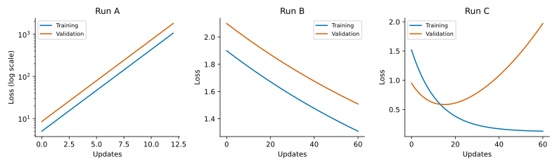

Why is a model not learning well, and what should we change? This session connects predictions made on paper with controlled experiments in a notebook. The model is linear; no neural networks or backpropagation knowledge is required.

Read the [optimization and regularization chapter](https://healthml.github.io/deep-learning-book/chapters/03-optimization-regularization/concepts.html) beforehand. You need partial derivatives, the scalar chain rule, vectors, and training/validation splits. Optional additional material is not required.

## Session route

| Activity                                 | Where                    | Minutes |
|----------------------------------|--------------------|-----------------:|
| 1\. Predict the update                   | This worksheet, on paper |      18 |
| 2\. Repair the optimizer                 | Notebook                 |      25 |
| 3\. Optional: investigate gradient noise | Notebook                 |      15 |
| 4\. Optional: fitting and generalization | Notebook                 |      17 |
| 5\. Diagnose unfamiliar runs             | This worksheet, on paper |      20 |

The **core route is 63 minutes** (activities 1, 2, and 5). Optional notebook activities 3–4 add 32 minutes; completing all activities takes **95 minutes**. Work in pairs during experiments and switch who operates the computer after each activity. Write a prediction before running a comparison. The final response is individual.

Install the environment using the [Week 3 setup instructions](https://github.com/HealthML/deep-learning-exercises/blob/main/exercises/week03/README.md). Open [the notebook](https://github.com/HealthML/deep-learning-exercises/blob/main/exercises/week03/optimization.ipynb) for core activity 2 through RMSProp; activities 3–4 are optional extensions. Questions and response spaces are in the notebook. If setup is not working at the start, pair with a working machine.

## 1. Predict the update

### 1A. Reuse a calculation

For one observation, let

$$z=wx+b,\qquad r=z-y,\qquad \ell=\frac12r^2.$$

Take $x=2$, $y=1$, $w=1$, and $b=0$.

1.  Calculate $z$, $r$, and $\ell$.
2.  Calculate $\partial\ell/\partial w$ and $\partial\ell/\partial b$ using the chain rule. Show the factors you multiply.
3.  Both derivatives depend on the residual $r$. Can we calculate it once and use it for both derivatives? After updating $w$ and $b$, can we use that same residual again? Explain.

### 1B. Two directions, one learning rate

Consider the synthetic objective

$$L(u,v)=\frac12(u^2+10v^2).$$

It has its minimum at $(0,0)$. Both coordinates are parameters, not data points.

Start at $(u,v)=(1,1)$.

1.  Calculate the gradient of $L$ and evaluate it at the starting point.
2.  Calculate the new parameters after one gradient-descent update for each learning rate: $\eta=0.01$, $0.1$, and $0.25$. Start from $(1,1)$ each time.
3.  Calculate the loss at the starting point and after each of these updates. Which learning rates decrease the loss?
4.  For $\eta=0.25$, continue from the parameters you obtained in question 2 and calculate a second update. Calculate its loss. Describe what happens to each coordinate's distance from zero over these two updates. Why does this learning rate cause trouble even though one coordinate moves closer to the minimum?

Keep your calculations for the notebook comparison.

::: {.callout-note collapse="true"}
## Optional extension: when will repeated updates converge?

The update equations can also be written as

$$u_{t+1}=(1-\eta)u_t,\qquad v_{t+1}=(1-10\eta)v_t.$$

This means that each update multiplies the current coordinate by the same number. For example, with $\eta=0.1$, each new $u$ is $0.9$ times its previous value. Repeating this gives $u_t=0.9^t u_0$, which approaches zero.

More generally, a sequence $a_{t+1}=qa_t$ approaches zero from every starting value when $|q|<1$. A negative $q$ also reverses the sign at each step.

Using this fact, find the positive learning rates for which **both** coordinates converge to zero from any starting point. Check whether the rates in question 2 fall within your range.
:::

## 2. Core experiment and optional extensions — notebook

Continue in `optimization.ipynb` through the RMSProp comparison for the core optimizer activity. If time allows, activities 3–4 are optional extensions: minibatch noise, then regularization and generalization. They introduce a synthetic regression dataset. Record experimental answers in the notebook; there is no duplicate questionnaire here.

## 5. Diagnose unfamiliar runs

Run A shows losses recorded during an actual gradient-descent run on synthetic regression data. Runs B and C are illustrative curves drawn to represent diagnostic scenarios; they are not measured training histories. None of these curves is taken from the notebook. Each panel describes a different run, so compare training and validation within a panel rather than ranking absolute losses across panels. The vertical scales differ; Run A uses a logarithmic loss axis. Curves suggest explanations; they do not establish a unique cause.

{#fig-week03-diagnosis fig-cap="One recorded synthetic-data experiment (A) and two illustrative loss histories (B–C)."}

1.  **For each panel**, state one plausible explanation and cite a feature of the curves supporting it.
2.  Propose **one** intervention for each run. Predict the change you would expect if your explanation were correct. Avoid changing several settings at once.
3.  **Individual response:** A colleague says, “This configuration has the lowest training loss, so we should publish it as our best model.” What evidence is missing, and which data should be used to select settings and assess the final model?

## Sources and conventions

These exercises were written to accompany Chapter 3 of the HealthML deep-learning book. The quadratic is a synthetic mathematical example; the notebook data are synthetic, and the diagnostic figure distinguishes recorded losses from illustrative curves. The loss convention is half mean squared error and the L2 penalty is $\lambda\|w\|_2^2$, with an unpenalized intercept. See the chapter for literature references and the [repository license](https://github.com/HealthML/deep-learning-exercises/blob/main/LICENSE.md) for reuse terms.