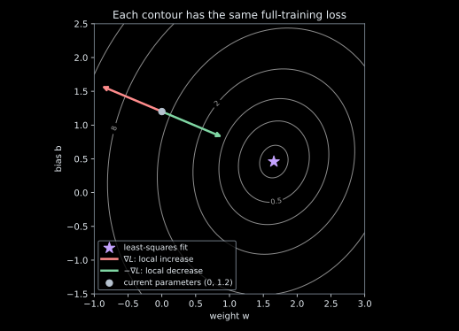

Work in pairs: one person operates the computer; the other predicts and records.
Switch roles after three trials. Follow the setup in
[the exercise README](https://github.com/HealthML/deep-learning-exercises/blob/main/exercises/week1/README.md).
No earlier reading is assumed. The lecturer will introduce each next task.

## 1. A model with one adjustable number — 5 minutes

A sensor reading $x$ is the input; the reference measurement $y$ is the target.
Start with $\hat y=wx$: the bias is fixed at zero.

Before running anything, sketch what the line does when $w$ increases. Which
point belongs to every possible line in this model? Then run at most three trials:

```sh
python exercises/week1/starter.py --w 0 --plot
python exercises/week1/starter.py --w 1 --plot
python exercises/week1/starter.py --w 2 --plot
```

| Trial | Weight $w$ | What you predicted | What you observed | Printed score |
|---|---|---|---|---|
| 1 | | | | |
| 2 | | | | |
| 3 | | | | |

Choose your next weight and explain why. Can changing $w$ move the prediction
at $x=0$? What additional parameter would let the line move vertically?

## 2. Free the bias — 2 minutes

Now use $\hat y=wx+b$. Predict the separate effects of changing $w$ and $b$.
Try one pair, then change **only one** parameter:

```sh
python exercises/week1/starter.py --model affine --w 1.5 --b 0 --plot
python exercises/week1/starter.py --model affine --w 1.5 --b 0.5 --plot
```

Write your best pair: $w=$ ______, $b=$ ______. Keep the training and held-out
sets separate: use only the displayed training measurements for these choices.

## 3. Define the loss and check a partial derivative — 3 minutes

After the lecturer introduces least squares, use residual
$r^{(i)}=wx^{(i)}+b-y^{(i)}$ and

$$
L(w,b)=\frac1n\sum_{i=1}^n(r^{(i)})^2.
$$

For the tiny example $(x,y)=(1,2),(2,3)$ and $w=b=0$, fill in:

| Quantity | Your value |
|---|---|
| Two residuals | |
| Mean squared loss | |
| $\partial L/\partial w$ | |
| $\partial L/\partial b$ | |

What is held fixed when taking $\partial L/\partial w$? Estimate it by changing
the weight a small amount in both directions while keeping the bias unchanged.
Compare your explanation with:

```sh
python exercises/week1/starter.py --model affine --method partials --w 0.5 --b 0
```

The script uses a centered finite difference. Explain why changing the bias at
the same time would fail to isolate this partial derivative.

## 4. Propose a fitting rule before seeing one — 3 minutes

Write a rule someone else could follow. State which measurements it uses, what
changes in one step, and when it stops. Compare your rule with another pair.

- Could you solve for the best weight with the bias fixed?
- Could you then solve for the best bias with that new weight fixed?
- Would repeating those two operations raise or lower the full squared loss?
- Is this coordinate ascent or coordinate descent? Explain the objective's role.

The lecturer will derive the coordinate updates before you run:

```sh
python exercises/week1/starter.py --model affine --method coordinate --steps 5
```

## 5. Read a gradient vector — guided discussion




Use these two-dimensional loss contours. The axes are parameters $w,b$,
not a sensor reading and target. Each contour contains equally good parameter
pairs. The gradient is

$$
\nabla L(w,b)=
\begin{bmatrix}
\frac{2}{n}\sum_i r^{(i)}x^{(i)}\\
\frac{2}{n}\sum_i r^{(i)}
\end{bmatrix}.
$$

Predict which arrow points toward local increase. Why use the negative gradient
for minimization? Does doubling the step length always improve the loss?

## 6. One example, then all examples — guided discussion

For one training example, use $\ell_i(w,b)=(wx_i+b-y_i)^2$. Its derivatives are
$2r_i x_i$ and $2r_i$. Compute **both** at the old parameters, then change both
parameters together. The script samples uniformly, with replacement.

```sh
python exercises/week1/starter.py --model affine --method sgd --lr 0.025 --steps 1
python exercises/week1/starter.py --model affine --method sgd --lr 0.025 --steps 40
python exercises/week1/starter.py --model affine --method batch --lr 0.1 --steps 1
```

What information is needed by one SGD update? By one batch update? If one
example's loss falls, must the full training loss fall? Distinguish the sampled
example's loss from the full training MSE in the printed output.

Discuss whether comparing **40 updates** of each method is a fair comparison of
examples processed. Do not tune against the reserved test set.

## 7. Direct least squares — closing check

Build $A$ with a column of sensor readings and a column of ones. Solve
$\min_\theta\|A\theta-y\|_2^2$ with $\theta=[w,b]^T$:

```sh
python exercises/week1/starter.py --model affine --method lstsq
```

How does this result compare with your hand-chosen pair? Why can this particular
model be solved directly? Which part of the iterative recipe would still work
for a model whose objective has no practical direct solve?
